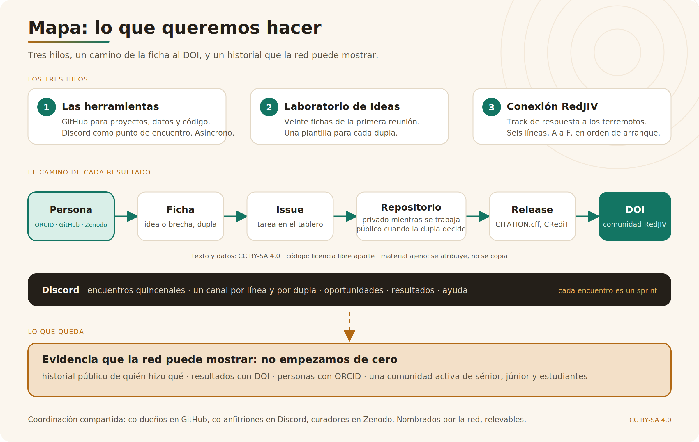

# Red de Jóvenes Investigadores de Venezuela · espacio de trabajo

Aquí trabaja la red: proyectos, datos y código, con autoría clara y resultados citables. Es una organización abierta de la Red de Jóvenes Investigadores de Venezuela (RedJIV), grupo de la Academia de Ciencias Físicas, Matemáticas y Naturales.

## Hacia dónde vamos

Lo que montamos no es para una sola emergencia ni para un solo proyecto. Es la infraestructura de la red para los próximos años: un lugar donde investigar, formar y divulgar queden registrados, con autoría clara y resultados citables.

Cada proyecto en GitHub deja un historial público de quién hizo qué. Cada resultado en Zenodo recibe un DOI y queda en la comunidad de la red. Cada persona con ORCID acumula su trayectoria. Cada encuentro en Discord deja huella de una comunidad activa, con investigadores sénior, júnior y estudiantes trabajando juntos. Es lo que una agencia de financiamiento quiere ver antes de apostar: que no se empieza de cero.

## Tres hilos y un hackathon

1. Las herramientas: GitHub para el trabajo, Discord como punto de encuentro, trabajo asíncrono. Encuentros quincenales; cada encuentro es un sprint.
2. El Laboratorio de Ideas: las fichas del ejercicio de emparejamiento de la red, y una plantilla para que cada dupla pase de la ficha al proyecto.
3. Conexión RedJIV: el track dedicado a la respuesta a los terremotos del 24 de junio de 2026. Página pública: https://venezuela-org.github.io/site/ · Plan: https://venezuela-org.github.io/plan/
4. CoAfina, el hackathon latinoamericano de datos abiertos del que esta forma de trabajar es la edición permanente: https://laa-hecap.github.io/coafina/

## Cómo entrar

1. Crea tus cuentas en cadena: [guía](../guias/01-cuentas-en-cadena.md) (ORCID, GitHub, Zenodo, Discord; quince minutos).
2. Pide acceso en el servidor de Discord de la red (enlace en la convocatoria de cada encuentro).
3. Toma una tarea del tablero de la organización etiquetada `primera-tarea` y entrégala: [guía del primer aporte](../guias/02-primer-aporte.md).
4. Elige dónde sumarte: una dupla del Laboratorio de Ideas, una línea de Conexión RedJIV, o ambas.

Programa completo de formación: [docs/programa.md](../docs/programa.md).

## Reglas de la casa

- Quien hace el trabajo firma primero. La mentoría acompaña y se declara con su rol CRediT.
- Texto y datos: CC BY-SA 4.0. Código: licencia libre aparte. Lo ajeno se atribuye, no se copia. [Guía](../guias/03-licencias-y-atribucion.md)
- Nada de datos personales de terceros, nada de información de víctimas sin verificar, nada de datos de menores. [Clasificación de datos](../guias/04-clasificacion-de-datos.md)
- Seudónimos bienvenidos. El perfil bajo de quien está dentro del país es parte del diseño.
- La coordinación es un rol compartido y relevable, nombrado por la red. No hay dueño único.

[Código de conducta](../CODE_OF_CONDUCT.md) · [Cómo contribuir](../CONTRIBUTING.md) · [Seguridad](../SECURITY.md)
